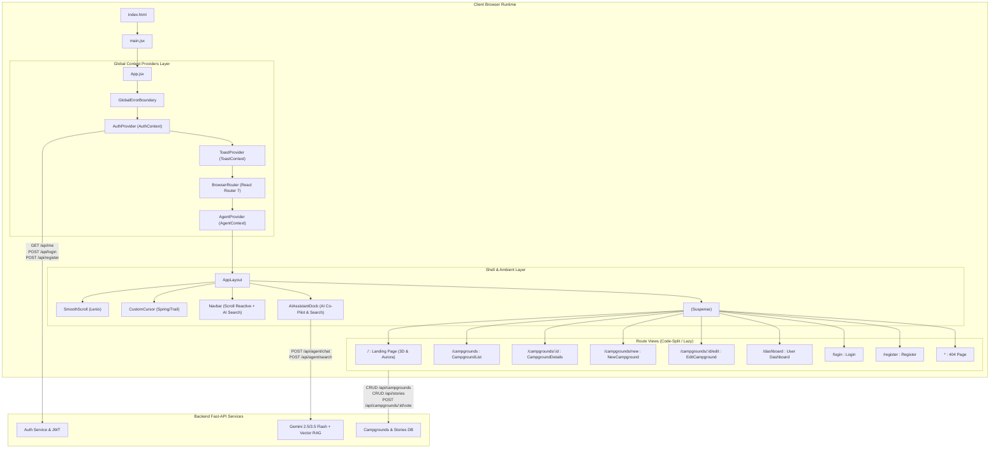
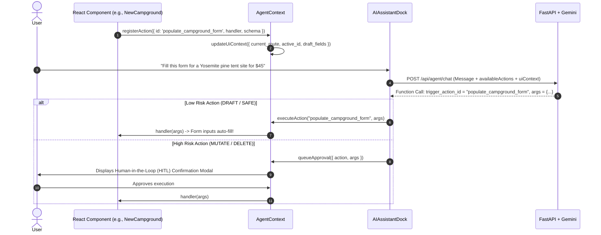

# YelpCamp Frontend (`frontend-ver2`) — Complete Architecture & Functional Guide

## 1. High-Level System Architecture & Flow



---

## 2. Directory Structure & File Map

```
frontend-ver2/src/
├── main.jsx                     # Vite entry point, mounts <App /> to DOM
├── App.jsx                      # App root, provider stack, and route definitions
├── index.css                    # Tailwind CSS v4 design tokens, aurora keyframes, base styling
├── api.js                       # Axios instance with baseURL and Bearer token interceptor
│
├── agent/
│   └── manifest.js              # Universal AI UI capability manifest & semantic schema definitions
│
├── context/
│   ├── AuthContext.jsx          # JWT authentication, session hydration, and login/logout state
│   ├── AgentContext.jsx         # AI tool registry, HITL approval queue, and UI context state machine
│   └── ToastContext.jsx         # Non-blocking notification toasts (success, error, info)
│
├── hooks/
│   ├── useAgentAction.js        # Dynamic mount/unmount registration of UI component actions for AI
│   ├── useAgentChat.js          # Chat loop, streaming/agent queries, and execution dispatch
│   ├── useAgentFormSync.js      # Two-way sync between form state and AI auto-fill capabilities
│   ├── useCampgrounds.js        # Fetching, searching, and filtering campsites
│   ├── useVote.js               # Upvoting/downvoting campgrounds with optimistic UI updates
│   ├── useWishlist.js           # Bookmark/save campgrounds with optimistic state
│   └── useToast.js              # Convenience hook to trigger toasts
│
├── components/
│   ├── Navbar.jsx               # Fixed top nav, scroll blur transition, auth actions, mobile drawer
│   ├── AIAssistantDock.jsx      # Slide-out AI assistant dock (Chat, Vector Search, HITL approvals)
│   ├── AmbientAtmosphere.jsx    # High-performance procedural Canvas 2D Aurora Borealis & Starfield
│   ├── CampHorizon.jsx          # Layered vector mountain horizon, tent glow, campfire ember particles
│   ├── SleekMasterpieceHero.jsx # Hero showcase with responsive typography and primary CTAs
│   ├── CampsiteBento.jsx        # Bento grid layout highlighting campsite features & perks
│   ├── CamperStories.jsx        # Community testimonials & photo moments
│   ├── CustomCursor.jsx         # Interactive magnetic smooth follower cursor
│   ├── Magnetic.jsx             # Physics-based spring attraction wrapper for interactive elements
│   ├── SmoothScroll.jsx         # Lenis smooth inertial scrolling wrapper
│   ├── ScrollReveal.jsx         # Intersection-observer scroll reveal animations
│   ├── SharePropertyModal.jsx   # One-click share suite (WhatsApp, X, Copy Link, QR Code)
│   ├── GoogleSignInButton.jsx   # Google OAuth authentication button
│   ├── CanvasErrorBoundary.jsx  # Fallback boundary for WebGL/Canvas rendering
│   ├── Icons.jsx                # Curated SVG icons (Feather/Lucide style)
│   │
│   ├── layout/
│   │   ├── AppLayout.jsx        # Global shell: Nav, main container, skip-links, and AI Dock
│   │   └── GlobalErrorBoundary.jsx # Catches uncaught runtime errors with recovery buttons
│   │
│   ├── stories/
│   │   ├── StoryBar.jsx         # 24hr Instagram-style camper photo story avatars
│   │   ├── StoryUploadModal.jsx # Multi-image camera/file upload with tagging & captioning
│   │   └── StoryViewerModal.jsx # Fullscreen touch/keyboard carousel story player with progress bars
│   │
│   ├── comments/
│   │   └── ThreadedComments.jsx # Nested discussions, reply threads, and moderator controls
│   │
│   ├── skeletons/
│   │   ├── CampgroundCardSkeleton.jsx
│   │   ├── CampgroundDetailsSkeleton.jsx
│   │   └── DashboardSkeleton.jsx
│   │
│   └── common/
│       ├── AgentActionBoundary.jsx # Highlights DOM elements targeted by the AI agent
│       └── SafeImage.jsx        # Image loader with graceful fallback on broken CDN/images
│
├── pages/
│   ├── Landing.jsx              # Immersive home landing page with 3D/Aurora visualizers
│   ├── CampgroundList.jsx       # Explore page with search bar, tags, and campsite grid
│   ├── CampgroundDetails.jsx    # Full campsite view (gallery, map, amenities, reviews, booking/share)
│   ├── NewCampground.jsx        # Create campsite form (AI auto-fill capable)
│   ├── EditCampground.jsx       # Edit campsite form (owner protected)
│   ├── Dashboard.jsx            # User profile, hosted campsites, wishlist bookmarks, uploaded moments
│   ├── Login.jsx                # Credentials and Google OAuth login
│   ├── Register.jsx             # New scout account registration
│   └── NotFound.jsx             # Custom 404 page with navigation fallbacks
│
└── utils/
    └── imageFallback.js         # Curated Unsplash fallback images and placeholder generators
```

---

## 3. Core Subsystems in Detail

### 3.1 Authentication & Session Management (`AuthContext.jsx`)
* **Dual Storage**: Stores JWT in `yelpcamp_token` and serialized user metadata in `yelpcamp_user`.
* **Client-Side Expiry Guard**: Checks token payload `exp` timestamp client-side before making requests to avoid unnecessary 401s.
* **Axios Interceptor (`api.js`)**: Automatically attaches `Authorization: Bearer <token>` to all outbound requests.
* **Methods Provided**:
  * `login(username, password)`
  * `register(username, password)`
  * `loginWithGoogle(credential)`
  * `logout()`
  * `checkAuth()`
  * `updateAvatar(url)`

---

### 3.2 Dynamic AI Co-Pilot State Machine (`AgentContext.jsx` & `AIAssistantDock.jsx`)
The application features a bidirectional AI agent co-pilot:



* **`useAgentAction`**: Components mount their capabilities to `AgentContext` and automatically unregister on unmount.
* **`useAgentFormSync`**: Binds form values so the AI can inspect what the user has typed and auto-complete missing fields.
* **Guided Tours**: Integrates `driver.js` to highlight relevant buttons and inputs on the screen when the AI explains features to the user.

---

### 3.3 Visitor Stories & Photo Moments (`components/stories`)
* **`StoryBar.jsx`**: Renders avatar circles at the top of the explore and detail pages showing camper stories from the past 24 hours. Ring colors indicate unread vs. viewed status.
* **`StoryViewerModal.jsx`**: Fullscreen modal mimicking modern social stories:
  * Segmented progress bars with auto-advance (5s per slide).
  * Pause on hold/mouse-down.
  * Keyboard navigation (Left/Right arrows, Escape).
* **`StoryUploadModal.jsx`**: Lets authenticated users snap or upload photos with location tags and captioning.

---

### 3.4 Campgrounds Engine & Explorer (`pages/CampgroundList.jsx` & `pages/CampgroundDetails.jsx`)
* **Real-time Querying**: Instant search by title and location with debouncing.
* **Optimistic Wishlist & Voting**:
  * `useVote`: Instant visual score increments with backend reconciliation.
  * `useWishlist`: Instant bookmark toggle with optimistic UI feedback.
* **Dynamic Sharing Suite**: One-click sharing via clipboard, WhatsApp API, X/Twitter intent, or dynamically generated QR Code.
* **Threaded Reviews**: Multi-level replies, verified camper badges, and author deletion protections.

---

### 3.5 Atmospheric Visual Layer (`components/AmbientAtmosphere.jsx` & `CampHorizon.jsx`)
* **Procedural Aurora Borealis**: Custom Canvas 2D engine rendering undulating harmonic waves with zero runtime performance cost.
* **Parallax Starfield**: Multi-depth twinkling stars and shooting meteors.
* **Accessibility**: Automatically checks `prefers-reduced-motion` to disable animations and renders an elegant static twilight sky.
* **Page-Aware Pause**: Canvas loops halt using `requestAnimationFrame` and document visibility listeners when tabs are inactive.
