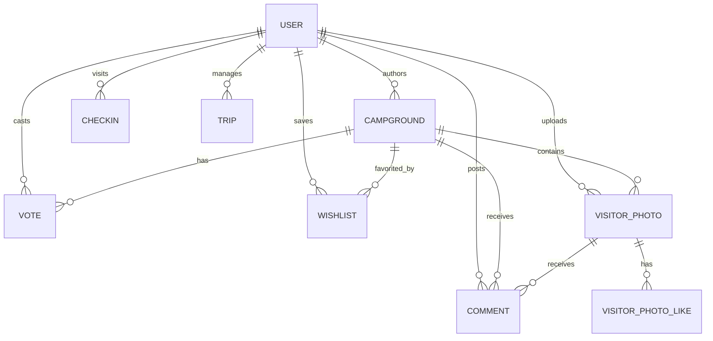

# Backend Context (`BE_CONTEXT.md`) — YelpCamp FastAPI Backend

> **Quick Summary**: The YelpCamp backend is a production-grade, asynchronous REST API built with **FastAPI**, **SQLModel** (SQLAlchemy + Pydantic v2), and **Turso (libSQL/SQLite)** with DiskANN vector search. It integrates **Google Gemini 3.5 & Multimodal Embedding models** for AI Co-Pilot agentic navigation and semantic search, **Cloudinary CDN** for media delivery, **Google OAuth 2.0 + JWT cookies/headers** for authentication, and **SlowAPI** for rate limiting.

---

## 1. Tech Stack & Environment

| Layer | Technology | Details / Purpose |
| :--- | :--- | :--- |
| **Framework** | FastAPI (`^0.115.0`) | Modern async web framework with automatic OpenAPI documentation (`/docs`) |
| **ASGI Server** | Uvicorn (`^0.30.0`) | High-performance ASGI server (`uvicorn main:app --host 127.0.0.1 --port 8000`) |
| **ORM & Validation** | SQLModel (`^0.0.22`) | Unifies SQLAlchemy models and Pydantic v2 validation schemas |
| **Database** | Turso (libSQL) / SQLite | Cloud libSQL via HTTP v2 pipeline (`turso_engine.py`) or local `database.db` |
| **AI & Embeddings** | Google Gemini (`google-genai`) | `gemini-embedding-2` (768-dim vectors) & `gemini-3.5-flash` for RAG and agent actions |
| **CDN & Image Storage** | Cloudinary (`cloudinary^1.41.0`) | Automated format conversion (WebP/AVIF), responsive delivery, and thumbnail crops |
| **Authentication** | PyJWT (`^2.9.0`) + Passlib | Secure JWT access tokens via HTTP-only cookies and `Authorization: Bearer <token>` |
| **Rate Limiter** | SlowAPI (`slowapi^0.1.9`) | IP-based rate limiting per route (auth, social actions, AI copilot, media upload) |

---

## 2. Architecture & Directory Layout

```text
backend/
├── main.py                     # App factory, lifespan startup, CORS, middleware, route mounting
├── config.py                   # Pydantic BaseSettings loading from .env
├── database.py                 # Engine factory (Turso vs SQLite), session generator, table init
├── models.py                   # SQLModel relational database models
├── schemas.py                  # Pydantic request/response validation schemas
├── security.py                 # Password hashing (bcrypt) & JWT encode/decode
├── dependencies.py             # Auth dependencies (get_current_user, is_logged_in, check_author)
├── turso_engine.py             # Custom DBAPI / cursor adapter for Turso Cloud HTTP v2 pipeline
├── routers/                    # Modular API route controllers
│   ├── auth.py                 # Register, login, logout, Google OAuth, /api/me
│   ├── campgrounds.py          # CRUD campsites, fast pagination, batched vote aggregation
│   ├── comments.py             # Nested / threaded comments on campgrounds & photos
│   ├── social.py               # Upvotes/downvotes, wishlists, check-ins, trips, dashboard
│   ├── visitor_photos.py       # Backcountry moments, 24h stories, photo likes, batch comments
│   └── vector_rag.py           # Vector search, RAG chat, AI Co-Pilot agent interaction & UI sync
├── services/                   # Business logic and external service clients
│   ├── cloudinary_service.py   # Cloudinary image upload, thumbnailing, DiceBear fallback avatars
│   ├── google_auth_service.py  # Google ID token verification via google-auth
│   ├── image_validator.py      # Content moderation and image URL sanitization
│   ├── limiter.py              # SlowAPI rate limiter instances and key extractors
│   ├── multimodal_embedder.py  # Gemini vision & text embedding generation pipeline
│   ├── rag_service.py          # Grounded RAG conversational engine with Gemini
│   ├── vector_store.py         # DiskANN vector index and cosine similarity search engine
│   └── vision_service.py       # Image captioning and scenery tag extraction
└── database.db                 # Local SQLite database fallback (500 seeded campgrounds)
```

---

## 3. Database Models & Schema (`models.py`)

The relational database schema is managed via SQLModel. All major entities support bidirectional relationships:



### Key Models:
* **`User`**: `id`, `username`, `hashed_password`, `avatar_url`. Relationships: `campgrounds`, `comments`, `wishlist`, `check_ins`, `votes`, `visitor_photos`.
* **`Campground`**: `id`, `title`, `price`, `image`, `description`, `location`, `location_address`, `gallery_images` (JSON list), `amenities` (JSON list), `rules` (JSON), `avg_rating`, `ai_media_caption`, `community_summary`, `author_id`, `author_username`.
* **`VisitorPhoto`**: `id`, `campground_id`, `user_id`, `user_username`, `user_avatar`, `media_type`, `image_url`, `caption`, `ai_tags` (JSON), `likes_count`, `created_at`, `expires_at` (null for permanent, Unix timestamp for 24h stories).
* **`Vote`**: `user_id`, `campground_id`, `vote_type` (`1` = like, `-1` = dislike). Primary key: `(user_id, campground_id)`.
* **`Comment`**: `id`, `text`, `parent_comment_id` (nested replies), `rating` (1-5), `author_id`, `author_username`, `author_avatar`, `campground_id`, `photo_id`, `created_at`.
* **`Wishlist`**: `id`, `user_id`, `campground_id`, `created_at`.
* **`CheckIn`**: `id`, `user_id`, `campground_id`, `created_at`.
* **`Trip` & `TripMember`**: Multi-camper collaborative trip planner.
* **`CampgroundEmbedding`**: High-dimensional vector embeddings (`768-dim`) stored for semantic RAG search.
* **`UINavigation`**: Registry of DOM element actions, feature names, and routes used by the AI Agent.

---

## 4. API Endpoints Reference

### 4.1 Authentication (`/api/auth` & `/api`)
| Method | Route | Description | Auth Required |
| :--- | :--- | :--- | :--- |
| `POST` | `/api/register` | Register new user; sets HTTP-only cookie + returns JWT | No |
| `POST` | `/api/login` | Login with username/password; sets cookie + returns JWT | No |
| `POST` | `/api/logout` | Clears auth cookie and session | No |
| `GET` | `/api/me` | Validates session and returns current user profile | Yes (Bearer/Cookie) |
| `POST` | `/api/auth/google` | Google OAuth 2.0 credential sign-in / signup | No |
| `POST` | `/api/me/avatar` | Upload and set profile picture on Cloudinary | Yes |

### 4.2 Campgrounds (`/api/campgrounds`)
| Method | Route | Description | Auth Required |
| :--- | :--- | :--- | :--- |
| `GET` | `/api/campgrounds` | Fast paginated campsite list with SQL `COUNT(*)` & batched votes | No |
| `POST` | `/api/campgrounds` | Create a campsite and trigger background multimodal embedding | Yes |
| `GET` | `/api/campgrounds/{id}` | Full campsite details, comments tree, and author info | No |
| `PUT` | `/api/campgrounds/{id}` | Update campsite details (author only) | Yes (Author) |
| `DELETE` | `/api/campgrounds/{id}` | Cascade delete campsite, comments, photos, votes, embeddings | Yes (Author) |
| `POST` | `/api/campgrounds/upload` | Upload campsite photo to Cloudinary CDN | Yes |

### 4.3 Social & Interactivity (`/api`)
| Method | Route | Description | Auth Required |
| :--- | :--- | :--- | :--- |
| `POST` | `/api/campgrounds/{id}/vote` | Toggle like (+1) or dislike (-1) on a campsite | Yes |
| `GET` | `/api/campgrounds/{id}/stats` | Get vote stats (`likes`, `dislikes`) | No |
| `POST` | `/api/campgrounds/{id}/wishlist` | Toggle campsite in user's saved wishlist | Yes |
| `GET` | `/api/me/dashboard` | Stats, hosted campsites, and wishlist for current user | Yes |
| `POST` | `/api/campgrounds/{id}/checkin` | Record a verified visit to a campground | Yes |
| `GET` | `/api/trips` | List collaborative trips for user | Yes |
| `POST` | `/api/trips` | Create new collaborative trip | Yes |

### 4.4 Stories & Backcountry Moments (`/api`)
| Method | Route | Description | Auth Required |
| :--- | :--- | :--- | :--- |
| `GET` | `/api/stories` | Active story tray grouped by user (capped at 40, batched comment counts) | No |
| `GET` | `/api/campgrounds/{id}/stories` | Stories & visitor photos for specific campsite | No |
| `POST` | `/api/campgrounds/{id}/stories` | Upload 24h story or permanent highlight | Yes |
| `POST` | `/api/stories/{photo_id}/like` | Toggle like on a visitor moment | Yes |
| `DELETE` | `/api/stories/{photo_id}` | Delete uploaded story (author only) | Yes (Author) |
| `GET` | `/api/stories/{photo_id}/comments` | Get comments on a story photo | No |
| `POST` | `/api/stories/{photo_id}/comments` | Add comment to a story photo | Yes |

### 4.5 AI Vector RAG & Agent (`/api/rag`, `/api/agent`)
| Method | Route | Description | Auth Required |
| :--- | :--- | :--- | :--- |
| `POST` | `/api/rag/search` | Natural language semantic vector search (`query`, `limit`, `min_score`) | No |
| `POST` | `/api/rag/chat` | Contextual conversational chatbot grounded in YelpCamp database | No |
| `POST` | `/api/agent/interact` | AI Co-Pilot agent execution with tool calling and UI spotlighting | No |
| `POST` | `/api/agent/sync-ui` | Sync current frontend route/modal state with backend AI Agent | No |

---

## 5. High-Performance Query Architecture

The backend implements strict patterns to prevent N+1 queries and high latency over Turso Cloud:

1. **Lightweight SQL `COUNT(*)`**: `list_campgrounds` runs `db.exec(select(func.count(Campground.id)).where(...)).one()`, avoiding loading all 501 rows into Python memory.
2. **Dedicated Card Formatter (`format_campground_card`)**: Serializes only grid-required fields without accessing unneeded relationships (`comments`, `visitor_photos`, `rules`).
3. **Batch-Grouped Votes**: Aggregates likes and dislikes for all paginated cards in **1 single SQL query**:
   ```sql
   SELECT campground_id, vote_type, count(user_id) 
   FROM vote 
   WHERE campground_id IN (1, 2, ... 12) 
   GROUP BY campground_id, vote_type;
   ```
4. **Batch Comment Counts for Stories**: `get_active_stories` queries comment counts in 1 grouped SQL query, eliminating lazy-load queries across dozens of photos.
5. **Guarded Schema Migrations**: Startup checks avoid firing 25+ redundant `ALTER TABLE` and `CREATE INDEX` queries over HTTP during server reloads.

---

## 6. Configuration & Environment Variables

Configured in `backend/.env` or deployment runtime:

```bash
# Core
PROJECT_NAME="YelpCamp API"
ENVIRONMENT="production"            # "production" | "development"
SECRET_KEY="<32+ char secret>"
ACCESS_TOKEN_EXPIRE_MINUTES=10080  # 7 days

# Database: Toggle between Cloud Turso and Local SQLite
DATABASE_URL="sqlite:///database.db"
USE_TURSO=True                      # Set False for 25ms local SQLite development
TURSO_DATABASE_URL="https://yelpcamp-db-...turso.io"
TURSO_AUTH_TOKEN="<turso jwt token>"

# Cloudinary CDN
CLOUDINARY_CLOUD_NAME="<cloud_name>"
CLOUDINARY_API_KEY="<api_key>"
CLOUDINARY_API_SECRET="<api_secret>"

# Google OAuth 2.0
GOOGLE_CLIENT_ID="<client_id>.apps.googleusercontent.com"
GOOGLE_CLIENT_SECRET="<client_secret>"

# Google Gemini RAG
GEMINI_API_KEY="<gemini_api_key>"
EMBEDDING_MODEL="gemini-embedding-2"
CHAT_MODEL="gemini-3.5-flash"
VISION_MODEL="gemini-3.5-flash"
```

---

## 7. Running the Backend Locally

```powershell
# From the backend directory:
cd d:\Projects\yelpCamp\backend

# Activate virtualenv and start Uvicorn
.\venv\Scripts\python.exe -m uvicorn main:app --host 127.0.0.1 --port 8000 --reload
```
* Interactive API Documentation (Swagger UI): `http://127.0.0.1:8000/docs`
* Alternative Redoc Documentation: `http://127.0.0.1:8000/redoc`
