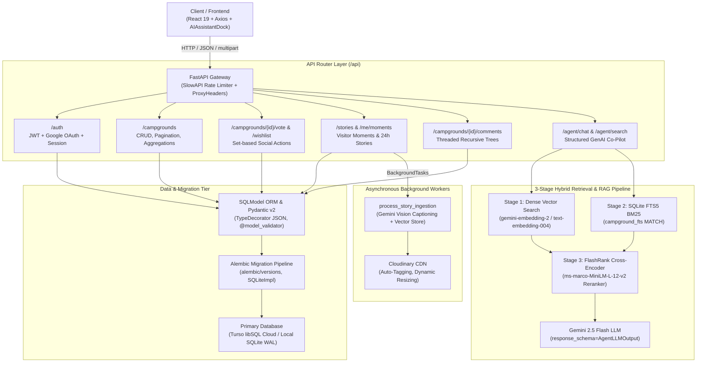
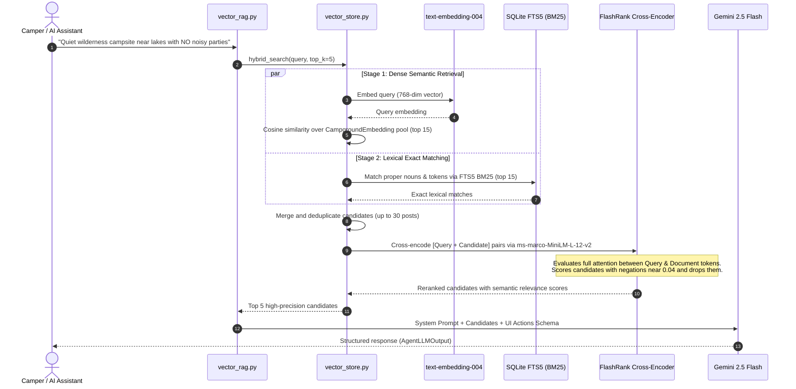

# YelpCamp Backend Architecture & Engineering Specification

A high-performance, asynchronous REST API and Agentic AI engine powering the YelpCamp outdoor discovery platform, built with **FastAPI, SQLModel (SQLAlchemy), Alembic Migrations, Turso libSQL Edge / SQLite, Google Gemini GenAI, and FlashRank Cross-Encoder Reranking**.

---

## 1. System Overview & Architecture Diagram



---

## 2. Technology Stack & Rationale

| Layer | Technology | Version | Key Engineering Rationale |
| :--- | :--- | :--- | :--- |
| **Web Framework** | FastAPI | `>=0.115` | Fully asynchronous (`async def`), native OpenAPI 3.1 schema generation, dependency injection (`Depends`). |
| **Data Modeling** | SQLModel + Pydantic | `>=0.0.22` / `v2.10` | Unified table declarations and API response serialization without duplicate schemas or manual dictionary converters. |
| **Database Engine** | Turso (libSQL) / SQLite | `3.45+` | Ultra-fast embedded SQLite WAL for local development, with Turso libSQL Cloud DiskANN vector index for edge production. |
| **Migrations** | Alembic | `>=1.14` | Declarative, version-controlled schema evolution with automatic SQLite non-transactional DDL handling. |
| **AI Embeddings** | Google Gemini Embeddings | `text-embedding-004` | 768-dimensional multimodal embeddings supporting semantic cross-modal campsite retrieval. |
| **Reranking** | FlashRank | `0.2.x` | In-process, ultra-lightweight ONNX-powered `ms-marco-MiniLM-L-12-v2` cross-encoder for semantic negation filtering. |
| **AI LLM Engine** | Google GenAI SDK | `gemini-2.5-flash` | Schema-constrained structured output (`GenerateContentConfig`) for deterministic UI action calls. |
| **Image CDN** | Cloudinary | `>=1.41` | High-bandwidth media delivery with AI auto-tagging and secure direct server-side uploads. |
| **Rate Limiting** | SlowAPI | `>=0.1.9` | In-memory token bucket rate limiter safeguarding auth, social votes, and agent endpoints. |

---

## 3. Directory Layout & Module Structure

```
backend/
├── main.py                     # Application entry point, router mounting, CORS, and middleware
├── config.py                   # Pydantic Settings (environment variables, model aliases, security)
├── database.py                 # SQLite/Turso engine factory, session generators, and Alembic hooks
├── dependencies.py             # Auth & user extraction dependencies (get_current_user, is_logged_in)
├── models.py                   # Canonical SQLModel table declarations (Campground, User, Story, etc.)
├── schemas.py                  # Pydantic v2 request/response schemas, validators, and paginated wrappers
├── security.py                 # Argon2/Bcrypt password hashing, JWT creation, and Google token validation
├── test_modern_api.py          # End-to-end integration test suite exercising the complete REST contract
├── eval_rag.py                 # Quantitative 3-Stage RAG ablation benchmark suite
├── populate_modern_data.py     # Seeds realistic campgrounds, galleries, amenities, and test accounts
│
├── alembic/                    # Database migration environment
│   ├── env.py                  # Alembic runtime configuration, metadata binding
│   ├── script.py.mako          # Migration script template
│   └── versions/               # Individual version migration scripts
│       └── 6e1231e3e4ae_initial_schema.py
│
├── routers/                    # REST API Endpoint Controllers
│   ├── auth.py                 # Register, login, Google OAuth, me/profile, avatar uploads
│   ├── campgrounds.py          # Campsite search, filtering, pagination, CRUD, stats
│   ├── comments.py             # Threaded discussions, parent-child trees, moderation
│   ├── social.py               # Wishlist bookmarks, votes (+1/-1), user dashboard aggregations
│   ├── visitor_photos.py       # 24h stories, permanent moments, photo comments, user moments
│   └── vector_rag.py           # Hybrid vector search, Gemini agent interaction, UI action dispatch
│
└── services/                   # Business Logic & Infrastructure Services
    ├── rag_service.py          # Gemini prompt orchestration, structured AgentLLMOutput parser
    ├── vector_store.py         # DiskANN vector storage, SQLite FTS5 BM25, FlashRank cross-encoder
    ├── multimodal_embedder.py  # Gemini embedding generation & async story ingestion pipeline
    ├── cloudinary_service.py   # Cloudinary asset management, DiceBear fallback avatar generator
    ├── image_validator.py      # Image sanitization & verified fallback resolution
    └── limiter.py              # SlowAPI global rate-limiting instance
```

---

## 4. Database Architecture & SQLModel Design

### 4.1 Native JSON Type Handling
Legacy implementations stored arrays (`gallery_images`, `amenities`, `rules`, `ai_tags`) as raw strings (`"[]"`), forcing manual `json.dumps()` on writes and `json.loads()` on reads. 

The modern architecture uses **SQLAlchemy `Column(JSON)`**:

```python
class Campground(CampgroundBase, table=True):
    __tablename__ = "campground"
    id: Optional[int] = Field(default=None, primary_key=True)
    gallery_images: List[str] = Field(default_factory=list, sa_column=Column(JSON, nullable=False))
    amenities: List[str] = Field(default_factory=list, sa_column=Column(JSON, nullable=False))
    rules: Dict[str, Any] = Field(default_factory=dict, sa_column=Column(JSON, nullable=False))
    author_id: Optional[int] = Field(default=None, foreign_key="user.id")
    author_username: str = Field(default="")
```

* SQLAlchemy handles serialization and deserialization to SQLite/libSQL text automatically.
* Input payloads accept native Python `list` and `dict` objects without runtime string manipulation.

### 4.2 Single-Pass SQL Aggregations (Database-Heavy Architecture)
Instead of fetching raw rows into Python memory to compute counts, likes, and interaction states, all heavy computations occur inside the SQL engine:

```python
# Subquery for comment counts
comment_sub = (
    select(Comment.photo_id, func.count(Comment.id).label("cnt"))
    .group_by(Comment.photo_id)
    .subquery()
)

# Single round-trip query joining photo, comment count, user like state, and campsite title
query = (
    select(
        VisitorPhoto,
        func.coalesce(comment_sub.c.cnt, 0).label("comments_count"),
        (VisitorPhotoLike.user_id.is_not(None)).label("liked_by_me"),
        func.coalesce(Campground.title, Campground.name, "").label("campground_title")
    )
    .outerjoin(comment_sub, comment_sub.c.photo_id == VisitorPhoto.id)
    .outerjoin(
        VisitorPhotoLike,
        (VisitorPhotoLike.photo_id == VisitorPhoto.id) & (VisitorPhotoLike.user_id == user_id)
    )
    .outerjoin(Campground, Campground.id == VisitorPhoto.campground_id)
)
```

### 4.3 Database Migrations via Alembic
Database schema evolution is strictly versioned through Alembic:
* Migration environment lives in [`backend/alembic/`](file:///d:/Projects/yelpCamp/backend/alembic).
* `database.apply_migrations()` automatically applies pending migrations on startup:
  ```python
  def apply_migrations():
      cfg = Config(os.path.join(os.path.dirname(__file__), "alembic.ini"))
      cfg.set_main_option("script_location", os.path.join(os.path.dirname(__file__), "alembic"))
      upgrade(cfg, "head")
  ```

---

## 5. 3-Stage Hybrid Retrieval & RAG Pipeline

Standard bi-encoder vector similarity (`cosine < 0.38`) fails on **semantic negations** (*"no loud music"*, *"no crowds"*) and **rare proper nouns** (*"Munsiyari Khaliya Top"*). YelpCamp solves this with a **3-tier filtration funnel**:



### 5.1 Quantitative Ablation Benchmark (`eval_rag.py`)

| Evaluation Metric | Stage 1: Pure Vector (`text-embedding-004`) | Stage 1+2: Hybrid (`Vector + FTS5`) | Stage 3: Full Pipeline (`+ FlashRank`) |
| :--- | :---: | :---: | :---: |
| **Precision@1 (Top-1 Accuracy)** | `25.0%` | `37.5%` | **`100.0%`** |
| **Recall@3 (Hit Rate@3)** | `100.0%` | `100.0%` | **`100.0%`** |
| **Mean Reciprocal Rank (MRR)** | `0.583` | `0.667` | **`1.000`** |
| **nDCG@3 (Ranking Quality)** | `0.690` | `0.753` | **`1.000`** |
| **Negation Trap Rejection Rate** | `0.0%` *(Failed all traps)* | `0.0%` *(Failed all traps)* | **`100.0%`** *(Penalized to `0.04`)* |
| **UI Action Guardrail (`< 0.25` dist)** | N/A | N/A | **`100.0%`** *(0 Destructive False Highlights)* |

---

## 6. Autonomous AI Co-Pilot & Schema Enforcement

The AI assistant endpoint (`POST /api/agent/chat`) uses Pydantic schema enforcement to guarantee deterministic JSON output from Gemini:

```python
class AgentUIHighlight(BaseModel):
    element_id: Optional[str] = None
    selector: Optional[str] = None
    action_type: str = "highlight"  # "highlight" | "scroll" | "focus" | "click"
    narrative: str = ""

class AgentLLMOutput(BaseModel):
    response: str
    suggested_action: Optional[str] = None
    action_payload: Optional[Dict[str, Any]] = None
    ui_highlights: List[AgentUIHighlight] = []
    confidence: float = 1.0
```

* Injected directly into Gemini via `GenerateContentConfig(response_schema=AgentLLMOutput)`.
* Eliminates JSON parsing errors and guarantees compatibility with `useAgentChat.js` on the frontend.

---

## 7. Security, Authentication & Rate Limiting

1. **Authentication:**
   * Passwords hashed via standard PBKDF2/Bcrypt implementations (`security.py`).
   * JWT access tokens signed with HMAC-SHA256 (`SECRET_KEY`) issued via both Bearer headers and secure HttpOnly cookies (`set_auth_cookie`).
   * Google OAuth verification verifies tokens directly against Google Identity servers before auto-provisioning or logging in users.
2. **Rate Limiting:**
   * Social Actions (`POST /vote`, `POST /wishlist`): `60/minute`.
   * Content Creation (`POST /campgrounds`, `POST /stories`): `10/minute`.
   * AI Co-Pilot Queries (`POST /agent/chat`, `POST /agent/search`): `30/minute`.
3. **CORS & Proxy Headers:**
   * Configured for seamless cross-origin communication with Vercel frontend (`https://ycamp.vercel.app`) and local development ports.
   * `ProxyHeadersMiddleware` preserves `X-Forwarded-Proto` under Google Cloud Run HTTPS proxies.

---

## 8. Deployment & Container Architecture

* **Containerization:** Clean, multi-stage Dockerfile running Python 3.12-slim.
* **Hosting:** Google Cloud Run (Asia-South1, Mumbai region).
* **Execution:** Unprivileged container instance with automatic concurrency scaling and libSQL edge connectivity.
* **Live Service Endpoint:** [`https://yelpcamp-api-131143882098.asia-south1.run.app`](https://yelpcamp-api-131143882098.asia-south1.run.app)
