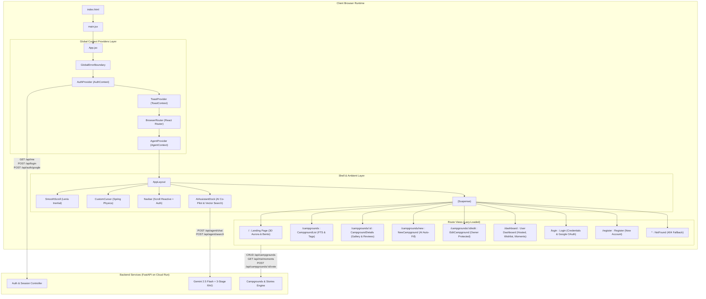
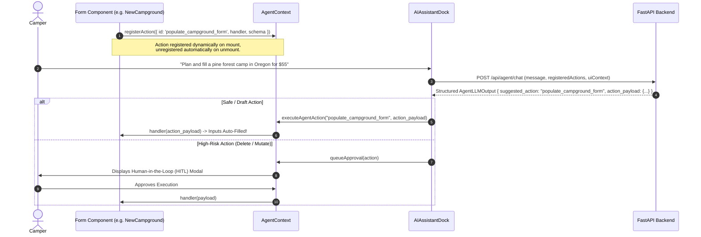

# YelpCamp Frontend Architecture & Engineering Specification

A responsive, immersive, and agent-assisted single-page application built with **React 19, Vite, Tailwind CSS v4, Lenis Smooth Scrolling, Canvas 2D Procedural Aurora Visualizers, and Driver.js Guided UI Spotlights**.

---

## 1. High-Level System Architecture & Component Flow



---

## 2. Technology Stack & Key Dependencies

| Subsystem | Technology | Version | Purpose in Application |
| :--- | :--- | :--- | :--- |
| **UI Library** | React | `19.x` | Modern reactive UI runtime utilizing React compiler, transitions, and suspense boundaries. |
| **Build Tool** | Vite | `8.x` | Lightning-fast development server with ES-module HMR and optimized Rollup production bundling. |
| **Styling** | Tailwind CSS v4 | `v4.x` | Modern `@theme` CSS design tokens, custom utility classes, and hardware-accelerated transitions. |
| **Smooth Scroll** | Lenis | `1.x` | High-fidelity, inertial smooth scrolling wrapper with momentum physics. |
| **Motion Physics** | Framer Motion | `12.x` | Gesture transitions, spring follower cursor, and layout-preserving accordion modals. |
| **UI Spotlight** | Driver.js | `1.x` | Interactive visual spotlighting highlighting DOM elements when guided by the AI assistant. |
| **Icons** | Lucide React | Latest | Clean, high-performance SVG iconography across the entire application interface. |
| **HTTP Client** | Axios | Latest | Configured client with `Authorization: Bearer` interceptors and cookie forwarding. |

---

## 3. Directory Layout & Module Structure

```
frontend-ver2/src/
├── main.jsx                     # Vite entry point, mounts <App /> to DOM
├── App.jsx                      # App root, provider stack, and route definitions
├── index.css                    # Tailwind CSS v4 tokens, aurora keyframes, base styling
├── api.js                       # Axios instance with baseURL and Bearer token interceptor
│
├── agent/
│   └── manifest.js              # Universal AI UI capability manifest & semantic schema definitions
│
├── context/
│   ├── AuthContext.jsx          # JWT authentication, session hydration, and login/logout state
│   ├── AgentContext.jsx         # AI tool registry, HITL approval queue, and UI context state machine
│   └── ToastContext.jsx         # Non-blocking notification toasts (success, error, info)
│
├── hooks/
│   ├── useAgentAction.js        # Dynamic registration of UI component actions for AI execution
│   ├── useAgentChat.js          # Chat loop, streaming agent queries, and action dispatch
│   ├── useAgentFormSync.js      # Two-way sync between form state and AI auto-fill capabilities
│   ├── useCampgrounds.js        # Fetching, searching, and filtering campsites
│   ├── useVote.js               # Upvoting/downvoting campgrounds with optimistic UI updates
│   ├── useWishlist.js           # Bookmark/save campgrounds with optimistic state
│   └── useToast.js              # Convenience hook to trigger toasts
│
├── components/
│   ├── Navbar.jsx               # Fixed top nav, scroll blur transition, auth actions, mobile drawer
│   ├── AIAssistantDock.jsx      # Slide-out AI assistant dock (Chat, Vector Search, HITL approvals)
│   ├── AmbientAtmosphere.jsx    # High-performance procedural Canvas 2D Aurora Borealis & Starfield
│   ├── CampHorizon.jsx          # Layered vector mountain horizon, tent glow, campfire ember particles
│   ├── SleekMasterpieceHero.jsx # Hero showcase with responsive typography and primary CTAs
│   ├── CampsiteBento.jsx        # Bento grid layout highlighting campsite features & perks
│   ├── CamperStories.jsx        # Community testimonials & photo moments
│   ├── CustomCursor.jsx         # Interactive magnetic smooth follower cursor
│   ├── Magnetic.jsx             # Physics-based spring attraction wrapper for interactive elements
│   ├── SmoothScroll.jsx         # Lenis smooth inertial scrolling wrapper
│   ├── ScrollReveal.jsx         # Intersection-observer scroll reveal animations
│   ├── SharePropertyModal.jsx   # One-click share suite (WhatsApp, X, Copy Link, QR Code)
│   ├── GoogleSignInButton.jsx   # Google Identity Services OAuth button
│   ├── CanvasErrorBoundary.jsx  # Fallback boundary for WebGL/Canvas rendering
│   ├── Icons.jsx                # Curated SVG icons (Feather/Lucide style)
│   │
│   ├── layout/
│   │   ├── AppLayout.jsx        # Global shell: Nav, main container, skip-links, and AI Dock
│   │   └── GlobalErrorBoundary.jsx # Catches uncaught runtime errors with recovery buttons
│   │
│   ├── stories/
│   │   ├── StoryBar.jsx         # 24hr Instagram-style camper photo story avatars
│   │   ├── StoryUploadModal.jsx # Multi-image camera/file upload with tagging & captioning
│   │   └── StoryViewerModal.jsx # Fullscreen touch/keyboard carousel story player with progress bars
│   │
│   ├── comments/
│   │   └── ThreadedComments.jsx # Nested discussions, reply threads, and author deletion protections
│   │
│   ├── skeletons/
│   │   ├── CampgroundCardSkeleton.jsx
│   │   ├── CampgroundDetailsSkeleton.jsx
│   │   └── DashboardSkeleton.jsx
│   │
│   └── common/
│       ├── AgentActionBoundary.jsx # Highlights DOM elements targeted by the AI agent
│       ├── ProtectedRoute.jsx   # Client-side authentication gate redirecting to /login
│       └── SafeImage.jsx        # Image loader with graceful fallback on broken CDN/images
│
├── pages/
│   ├── Landing.jsx              # Immersive home landing page with 3D/Aurora visualizers
│   ├── CampgroundList.jsx       # Explore page with search bar, tags, and campsite grid
│   ├── CampgroundDetails.jsx    # Full campsite view (gallery, map, amenities, reviews, booking/share)
│   ├── NewCampground.jsx        # Create campsite form (AI auto-fill capable)
│   ├── EditCampground.jsx       # Edit campsite form (owner protected)
│   ├── Dashboard.jsx            # User profile, hosted campsites, wishlist bookmarks, field moments
│   ├── Login.jsx                # Credentials and Google OAuth login
│   ├── Register.jsx             # New scout account registration
│   └── NotFound.jsx             # Custom 404 page with navigation fallbacks
│
└── utils/
    └── imageFallback.js         # Curated Unsplash fallback images and placeholder generators
```

---

## 4. Core Subsystems & Interaction Patterns

### 4.1 Autonomous AI Co-Pilot State Machine (`AgentContext.jsx` & `AIAssistantDock.jsx`)

The frontend acts as an active **Dynamic Capabilities Registry** rather than a passive chat receiver:



* **`useAgentAction`**: Subscribes component functions (e.g. form filling, filtering, navigation) directly into the agent's tool set.
* **`useAgentFormSync`**: Bi-directionally links form fields so the assistant inspects what the user has drafted and completes missing details.
* **Guided Visual Spotlight (`driver.js`)**: Highlights specific DOM buttons and input fields as the assistant explains features.

---

### 4.2 Visitor Moments & 24h Stories (`components/stories/`)

* **`StoryBar.jsx`**: Displays camper avatars with animated status rings indicating unread vs. viewed moments.
* **`StoryViewerModal.jsx`**: Fullscreen mobile-touch and desktop keyboard story player:
  * Auto-advancing segmented progress bars (5 seconds per slide).
  * Pause on hold / mouse-down.
  * Direct campsite link navigation via `campground_title`.
  * Real-time like reaction toggle and nested reply submissions.
* **`StoryUploadModal.jsx`**: Camera upload, direct URL entry, ambiance tagging, and TTL expiration settings (24h or permanent).

---

### 4.3 Campgrounds Discovery & Interactions

* **Live Search & Tags (`CampgroundList.jsx`)**: Real-time debounced query filtering across titles and location tags.
* **Optimistic Social Actions:**
  * **`useVote`**: Optimistically increments/decrements campsite score with backend reconciliation.
  * **`useWishlist`**: Instant bookmark state toggle across cards and details pages.
* **Property Sharing Suite (`SharePropertyModal.jsx`)**: One-click sharing via Direct Link, WhatsApp Web API, X/Twitter intent, or dynamic QR code generation.
* **Threaded Discussions (`ThreadedComments.jsx`)**: Hierarchical reply tree with nested author avatars and delete permissions.

---

### 4.4 User Dashboard & Moments (`pages/Dashboard.jsx`)

The user dashboard provides a unified view across 3 dedicated tabs:
1. **Hosted Campsites:** Manage active listings, view metrics, and delete properties.
2. **Saved Wishlist:** Quick navigation to bookmarked campsites.
3. **Field Moments:** Fetches the authenticated user's uploaded moments directly from `GET /api/me/moments` (joined with `campground_title`), bypassing global story tray pagination caps.

---

### 4.5 Atmospheric Visual Engine (`components/AmbientAtmosphere.jsx`)

* **Procedural Aurora Borealis:** High-performance Canvas 2D engine rendering undulating harmonic waves with zero runtime performance cost.
* **Parallax Twinkling Stars:** Dynamic star density and shooting meteors rendered via native 2D canvas context.
* **Accessibility & Power Saving:**
  * Automatically detects `prefers-reduced-motion` and renders a calm, static twilight gradient.
  * Pauses `requestAnimationFrame` render loops automatically when the browser tab is hidden (`document.visibilityState === 'hidden'`).

---

## 5. Production Build & Deployment

* **Hosting:** Vercel Global Edge Network.
* **Build Command:** `npm run build` (`vite build`).
* **Output:** Static HTML/JS/CSS assets with gzip and Brotli pre-compression.
* **Production URL:** [`https://ycamp.vercel.app`](https://ycamp.vercel.app)

