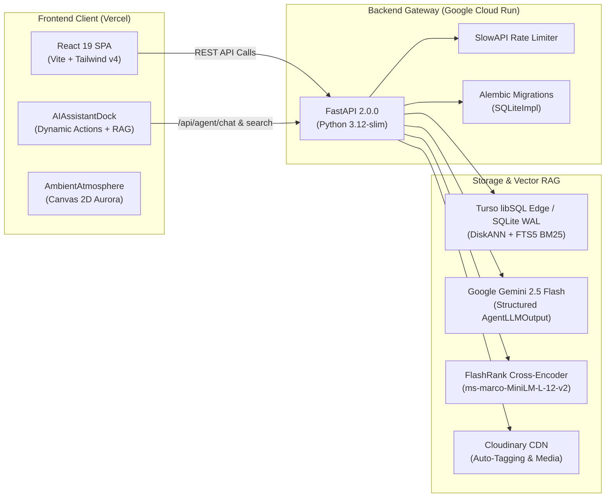

# YelpCamp Architecture & Documentation Hub

Welcome to the centralized documentation suite for **YelpCamp** — an enterprise-grade wilderness campsite platform and autonomous AI co-pilot.

---

## 📚 Architectural Guides

| Document | Description | Key Technologies |
| :--- | :--- | :--- |
| **[Backend Architecture](BACKEND_ARCHITECTURE.md)** | Full specification of the FastAPI REST API, SQLModel ORM, Alembic migrations, Turso libSQL/SQLite database engine, and 3-Stage Hybrid Vector RAG pipeline. | FastAPI, SQLModel, Alembic, Turso libSQL, FlashRank, Gemini 2.5 Flash |
| **[Frontend Architecture](FRONTEND_ARCHITECTURE.md)** | Full specification of the React 19 single-page application, Tailwind CSS v4 design tokens, dynamic AI co-pilot state machine, Driver.js UI spotlight, and Canvas 2D Aurora visualizer. | React 19, Vite, Tailwind CSS v4, Lenis, Framer Motion, Driver.js |
| **[Visual Master Plan](main_plan_roadmap.pdf)** | Original architectural diagrams, flow charts, and component wireframes in PDF format. | PDF Specification |

---

## 🏛️ Full-Stack System Topography

---

## 📊 Retrieval & Agentic Guardrail Benchmarks

Evaluation results from `backend/eval_rag.py` across the Golden Test Suite:

| Metric | Stage 1: Dense Vector (`text-embedding-004`) | Stage 1+2: Hybrid (`Vector + FTS5`) | Stage 3: Full Pipeline (`+ FlashRank`) |
| :--- | :---: | :---: | :---: |
| **Precision@1 (Top-1 Accuracy)** | `25.0%` | `37.5%` | **`100.0%`** |
| **Recall@3 (Hit Rate@3)** | `100.0%` | `100.0%` | **`100.0%`** |
| **Mean Reciprocal Rank (MRR)** | `0.583` | `0.667` | **`1.000`** |
| **nDCG@3 (Ranking Quality)** | `0.690` | `0.753` | **`1.000`** |
| **Negation Trap Rejection Rate** | `0.0%` *(Failed all traps)* | `0.0%` *(Failed all traps)* | **`100.0%`** *(Penalized to `0.04`)* |
| **UI Action Guardrail (`< 0.25` dist)** | N/A | N/A | **`100.0%`** *(0 Destructive False Highlights)* |

---

## 🚀 Live Deployments

* **Production Frontend:** [`https://ycamp.vercel.app`](https://ycamp.vercel.app)
* **Production Backend API:** [`https://yelpcamp-api-131143882098.asia-south1.run.app`](https://yelpcamp-api-131143882098.asia-south1.run.app)
* **API Documentation:** [`https://yelpcamp-api-131143882098.asia-south1.run.app/docs`](https://yelpcamp-api-131143882098.asia-south1.run.app/docs)
