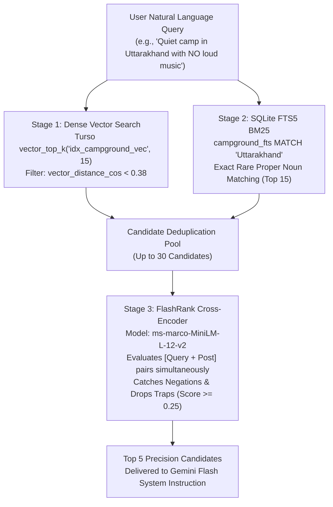
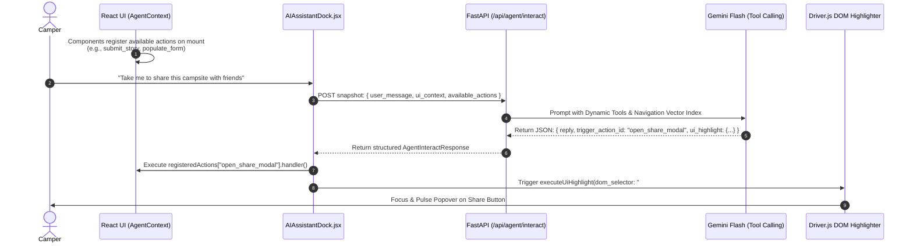

# YelpCamp Full-Stack Refactor & Feature Implementation Master Roadmap

> **Based on:** `main_plan_roadmap.pdf`, `property_sharing_and_visitor_stories_plan.md`, and `To build a production-grade Retriev.txt`.  
> **Target Architecture:** FastAPI (Python) + Turso libSQL (DiskANN + SQLite FTS5) + Google Gemini (Flash & Embeddings) + React 19 (Vite, TailwindCSS, Driver.js).

---

## 1. Executive Summary & Root Cause Analysis

An exhaustive audit of the existing codebase (`backend/` and `frontend-ver2/`) against the architectural master plan reveals **five critical system bottlenecks** causing features to behave statically, break at runtime, or deliver inaccurate recommendations:

```
┌────────────────────────────────────────────────────────────────────────────────────────┐
│                                CURRENT ARCHITECTURAL FLAWS                             │
├──────────────────────────────┬─────────────────────────────────────────────────────────┤
│ 1. Split-Brain Database      │ SQLModel ORM writes to SQLite while libSQL vector       │
│    Engines                   │ tables are decoupled; F32_BLOB(768) columns and FTS5    │
│                              │ indexes are not updated on write.                       │
├──────────────────────────────┼─────────────────────────────────────────────────────────┤
│ 2. Pure Bi-Encoder Vector    │ vector_top_k relies on cosine similarity alone. Fails   │
│    Trap                      │ on negations ("no loud music"), rare place names        │
│                              │ ("Munsiyari Khaliya Top"), and returns nearest button   │
│                              │ even when distance > 0.25 (causing false actions).      │
├──────────────────────────────┼─────────────────────────────────────────────────────────┤
│ 3. Disconnected Chat UI      │ AIAssistantDock is a passive text box without access to │
│                              │ active routes, open modals, or form state. Cannot       │
│                              │ trigger actions or highlight UI elements.               │
├──────────────────────────────┼─────────────────────────────────────────────────────────┤
│ 4. Synchronous Media         │ Upload endpoints call Gemini Vision and embedding       │
│    Ingestion                 │ generation synchronously, blocking the FastAPI event    │
│                              │ loop and triggering frontend timeouts.                  │
├──────────────────────────────┼─────────────────────────────────────────────────────────┤
│ 5. Missing Core Modules      │ vision_service.py and visitor_photos.py do not exist;   │
│                              │ comments are flat; StoryBar, StoryViewerModal, and      │
│                              │ SharePropertyModal are not yet implemented.             │
└──────────────────────────────┴─────────────────────────────────────────────────────────┘
```

---

## 2. Target System Architecture & Query Topography

### 2.1 3-Stage Hybrid Retrieval & Cross-Encoder Reranking
When a camper queries the Aurora Guide or search engine, queries traverse a 3-tier filtration funnel:



### 2.2 React UI State Machine & Dynamic Agent Loop
Instead of passing raw DOM trees or physical coordinates, the UI acts as a **Dynamic Capabilities Registry**:



---

## 3. Comprehensive Implementation Roadmap (Step-by-Step)

The implementation is structured into **8 coordinated execution phases**, maintaining strict contract compatibility between backend and frontend at each step.

| Phase | Title | Status |
|---|---|---|
| **Phase 1** | Unified Database Schema & Turso DDL Initialization | ✅ **COMPLETED** |
| **Phase 2** | Multimodal Vision AI & Async Background Ingestion | ✅ **COMPLETED** |
| **Phase 3** | 3-Stage Hybrid RAG & Dynamic Agent Router | 🔄 **IN PLANNING** |
| **Phase 4** | Visitor Stories, Property Hosting & Recursive Comments | ⏳ Queued |
| **Phase 5** | Frontend Dynamic Agent State Machine & Driver.js | ⏳ Queued |
| **Phase 6** | Instagram-Style Visitor Stories Suite | ⏳ Queued |
| **Phase 7** | Rich Hosting, Bento Grid Gallery & Share Suite | ⏳ Queued |
| **Phase 8** | Compatibility Matrix & End-to-End Validation | ⏳ Queued |

---

### Phase 1: Unified Database Schema & Turso DDL Initialization ✅ [COMPLETED]

#### Objectives
Synchronize SQLModel ORM models with native Turso libSQL tables, DiskANN vector indexes, and SQLite FTS5 virtual tables.


#### Tasks & Files
1. **Extend Campground Model in [`backend/models.py`](file:///d:/Projects/yelpCamp/backend/models.py)**:
   - Add columns:
     - `title`: `str = Field(index=True)` (add backwards-compatible alias or property for legacy `name`).
     - `price`: `float = Field(default=0.0)`
     - `location_address`: `Optional[str] = Field(default="")`
     - `gallery_images`: `str = Field(default="[]")` (JSON list of URL strings)
     - `amenities`: `str = Field(default="[]")` (JSON list: `["wifi", "campfire", "hot_showers", ...]`)
     - `rules`: `Optional[str] = Field(default="")`
     - `avg_rating`: `float = Field(default=0.0)`
     - `ai_media_caption`: `Optional[str] = Field(default="")`
     - `community_summary`: `Optional[str] = Field(default="")`
2. **Add Visitor Photos Models in [`backend/models.py`](file:///d:/Projects/yelpCamp/backend/models.py)**:
   - `VisitorPhoto`: `id`, `campground_id` (foreign key), `user_id` (foreign key), `user_username`, `user_avatar`, `media_type` (`photo` | `video`), `image_url`, `caption`, `ai_tags` (JSON string), `ai_media_caption`, `likes_count`, `created_at`, `expires_at` (Optional Unix epoch; `NULL` for permanent highlights, `+86400` for 24h stories).
   - `VisitorPhotoLike`: Composite key `(user_id, photo_id)` for idempotent like toggling.
3. **Upgrade Comment Model in [`backend/models.py`](file:///d:/Projects/yelpCamp/backend/models.py)**:
   - Add `parent_comment_id`: `Optional[int] = Field(default=None, foreign_key="comment.id", index=True)` for recursive threaded discussions.
   - Add `rating`: `Optional[int] = Field(default=None)` (1 to 5 stars on root reviews).
4. **Idempotent DDL & DiskANN / FTS5 Setup in [`backend/turso_engine.py`](file:///d:/Projects/yelpCamp/backend/turso_engine.py)**:
   - Run during FastAPI lifespan startup:
     ```sql
     -- Vector Columns
     ALTER TABLE campground ADD COLUMN embedding F32_BLOB(768);
     ALTER TABLE visitor_photos ADD COLUMN embedding F32_BLOB(768);

     -- DiskANN Vector Indexes
     CREATE INDEX IF NOT EXISTS idx_campground_vec ON campground (libsql_vector_idx(embedding));
     CREATE INDEX IF NOT EXISTS idx_stories_vec ON visitor_photos (libsql_vector_idx(embedding));

     -- SQLite FTS5 Virtual Table for Keyword / Proper Noun BM25 Matching
     CREATE VIRTUAL TABLE IF NOT EXISTS campground_fts USING fts5(
         title, description, location, location_address, amenities, ai_media_caption,
         content='campground', content_rowid='id'
     );

     -- UI Navigation Knowledge Base
     CREATE TABLE IF NOT EXISTS ui_navigation (
         id TEXT PRIMARY KEY,
         feature_name TEXT NOT NULL,
         route TEXT NOT NULL,
         dom_selector TEXT NOT NULL,
         description TEXT NOT NULL,
         embedding F32_BLOB(768)
     );
     CREATE INDEX IF NOT EXISTS idx_ui_nav_vec ON ui_navigation (libsql_vector_idx(embedding));
     ```
5. **Update [`backend/requirements.txt`](file:///d:/Projects/yelpCamp/backend/requirements.txt)**:
   - Verify `google-genai>=1.0.0`, `flashrank>=0.2.0`, `cloudinary>=1.41.0`, `libsql-client>=0.3.0`.

---

### Phase 2: Multimodal Vision AI & Async Background Ingestion ✅ [COMPLETED]

#### Objectives
Extract scenic tags and visual context from uploaded media via Gemini Flash and asynchronously update embeddings without stalling HTTP requests.

#### Tasks & Files
1. **Build Gemini Vision Service in [`backend/services/vision_service.py`](file:///d:/Projects/yelpCamp/backend/services/vision_service.py)**:
   - Implement `analyze_media_with_gemini(image_bytes: bytes, mime_type: str = "image/jpeg") -> dict`:
     - Calls `gemini-2.5-flash` (or `gemini-3.5-flash`) with structured schema output (`response_mime_type="application/json"`).
     - Returns JSON:
       ```json
       {
         "suggested_caption": "Atmospheric lakeside tent under pine trees at dusk",
         "ai_tags": ["lakefront", "stargazing", "pine_forest", "campfire"],
         "detailed_visual_description": "Terrain is rocky shoreline with clear waters. High elevation alpine weather. Suitable for 2-person tents."
       }
       ```
2. **Refactor Ingestion Worker in [`backend/services/multimodal_embedder.py`](file:///d:/Projects/yelpCamp/backend/services/multimodal_embedder.py)**:
   - Expose `get_text_embedding(text: str) -> list[float]` producing normalized 768-d vectors.
   - Implement `async def process_campground_ingestion(campground_id: int)`:
     - Aggregates title, location, description, amenities, rules, and vision analysis.
     - Generates 768-d vector, writes `UPDATE campground SET ai_media_caption = ?, embedding = vector32(?) WHERE id = ?`.
     - Syncs row to `campground_fts`.
   - Implement `async def process_story_ingestion(photo_id: int)`:
     - Generates vector for visitor photo based on caption + AI tags + visual description and updates `visitor_photos`.
   - Trigger workers via FastAPI `BackgroundTasks` in routers.

---

### Phase 3: 3-Stage Hybrid RAG & Dynamic Agent Router 🔄 [IN PLANNING]


#### Objectives
Eliminate the bi-encoder negation trap, support rare proper noun search, and provide grounded UI action recommendations with distance guardrails.

#### Tasks & Files
1. **Implement 3-Stage Retrieval in [`backend/services/vector_store.py`](file:///d:/Projects/yelpCamp/backend/services/vector_store.py)**:
   - Method `hybrid_search_campsites(db, query: str, min_rating: float = 0.0, limit: int = 5)`:
     - **Stage 1 (Dense Vector)**: Query `vector_top_k('idx_campground_vec', vector32(?), 15)` with `vector_distance_cos < 0.38`.
     - **Stage 2 (SQLite FTS5 BM25)**: Query `SELECT rowid FROM campground_fts WHERE campground_fts MATCH ? ORDER BY bm25(campground_fts) LIMIT 15`.
     - **Deduplication**: Merge unique IDs from Stage 1 & Stage 2.
     - **Stage 3 (FlashRank Reranking)**: Initialize `flashrank.Ranker(model_name="ms-marco-MiniLM-L-12-v2")`. Compute cross-encoder relevance scores for `(query, candidate_text)`. Filter out candidates with score `< 0.25` and return top 5.
2. **UI Navigation Vector Lookup in [`backend/services/vector_store.py`](file:///d:/Projects/yelpCamp/backend/services/vector_store.py)**:
   - Implement `find_ui_navigation_target(db, user_goal: str) -> Optional[dict]`:
     - Query `vector_top_k('idx_ui_nav_vec', vector32(?), 1)` joined with `ui_navigation`.
     - Enforce `WHERE vector_distance_cos(u.embedding, vector32(?)) < 0.25`.
     - If distance is `>= 0.25` or no match, return `None` (preventing wrong button highlights).
3. **Agent Interaction Endpoint in [`backend/routers/vector_rag.py`](file:///d:/Projects/yelpCamp/backend/routers/vector_rag.py)**:
   - Define Pydantic request & response schemas:
     ```python
     class AgentInteractRequest(BaseModel):
         user_message: str
         ui_context: Dict[str, Any] = {}
         available_actions: List[Dict[str, Any]] = []
         chat_history: List[Dict[str, str]] = []

     class AgentInteractResponse(BaseModel):
         reply: str
         campsite_results: List[Dict[str, Any]] = []
         story_results: List[Dict[str, Any]] = []
         trigger_action_id: Optional[str] = None
         action_args: Optional[Dict[str, Any]] = None
         ui_highlight: Optional[Dict[str, str]] = None  # {route, dom_selector, feature_name, description}
     ```
   - Connect `POST /api/agent/interact` using Gemini Flash with function definitions for `hybrid_search_campsites` and `find_ui_navigation_target`, with injected dynamic `available_actions`.

---

### Phase 4: Visitor Stories, Property Hosting & Recursive Comments Routers

#### Objectives
Provide dedicated REST endpoints for Instagram-style stories, 24h expiration filtering, like reactions, multi-image hosting, and recursive comments.

#### Tasks & Files
1. **Create Visitor Photos Router in [`backend/routers/visitor_photos.py`](file:///d:/Projects/yelpCamp/backend/routers/visitor_photos.py)**:
   - `POST /api/campgrounds/{id}/photos`: Accepts multipart upload, uploads to Cloudinary, runs Gemini Vision AI, sets `expires_at = int(time.time()) + 86400` if `is_story=True`, schedules background embedding.
   - `GET /api/campgrounds/{id}/stories`: Fetches unexpired photos (`expires_at IS NULL OR expires_at > unixepoch()`), grouped by `user_id` with avatar, user info, photos list, and `liked_by_me` boolean.
   - `GET /api/stories/explore`: Returns active trending stories across all campsites for the home page carousel.
   - `POST /api/photos/{photo_id}/like`: Idempotent toggle of `VisitorPhotoLike` and atomic update of `likes_count`.
   - `DELETE /api/photos/{photo_id}`: Allows photo author or campground host to delete.
2. **Upgrade Comments Router in [`backend/routers/comments.py`](file:///d:/Projects/yelpCamp/backend/routers/comments.py)**:
   - Support `parent_comment_id` in `POST /api/campgrounds/{id}/comments`.
   - Return nested comment hierarchy in `GET /api/campgrounds/{id}/comments`.
   - Background worker: After every 5 new comments on a campground, run a recursive SQLite CTE to aggregate threads, prompt Gemini to summarize community sentiment into `campground.community_summary`, and re-embed.
3. **Campground Endpoints in [`backend/routers/campgrounds.py`](file:///d:/Projects/yelpCamp/backend/routers/campgrounds.py)**:
   - Update `CampgroundCreate` & `CampgroundUpdate` to accept `gallery_images`, `amenities`, `rules`, and `location_address`.
4. **Register Router in [`backend/main.py`](file:///d:/Projects/yelpCamp/backend/main.py)**:
   - Register `visitor_photos.router` with prefix `/api`.

---

### Phase 5: Frontend Dynamic Agent State Machine & Driver.js Integration

#### Objectives
Transform `frontend-ver2` from a passive UI into an agentic state machine capable of contextual awareness, action execution, and DOM element spotlighting.

#### Tasks & Files
1. **Install Driver.js in `frontend-ver2`**:
   - `npm install driver.js`
2. **Build Agent Context in `frontend-ver2/src/context/AgentContext.jsx`**:
   - Manages:
     - `registeredActions`: Map of `{ id, description, parameters, handler }`.
     - `uiContext`: Tracks `current_route`, `active_campground_id`, `active_campground_title`, `open_modal`, `draft_fields`.
   - Listens to `useLocation()` to automatically update `current_route`.
   - Registers default global navigation actions: `navigate_home`, `navigate_explore`, `navigate_new_campground`, `navigate_dashboard`.
   - Exposes `registerAction(action)`, `updateUiContext(key, val)`, `executeAction(id, args)`, and `getCurrentSnapshot()`.
3. **Build Custom Hooks**:
   - `frontend-ver2/src/hooks/useAgentAction.js`: Registers component capabilities on mount and unregisters on unmount.
   - `frontend-ver2/src/hooks/useAssistantActions.js`: Wraps `driver.js` to execute `ui_highlight` payloads (navigates if needed, waits 300ms for DOM render, highlights element with popover).
4. **Mount AgentProvider in [`frontend-ver2/src/App.jsx`](file:///d:/Projects/yelpCamp/frontend-ver2/src/App.jsx)**:
   - Wrap the component tree within `<AgentProvider>`.
5. **Refactor [`frontend-ver2/src/components/AIAssistantDock.jsx`](file:///d:/Projects/yelpCamp/frontend-ver2/src/components/AIAssistantDock.jsx)**:
   - Strip all hardcoded mock responses and timers.
   - On message submit, call `POST /api/agent/interact` passing `getCurrentSnapshot()`.
   - Upon receiving response:
     - Display conversational text.
     - Render interactive campsite recommendation mini-cards with direct link buttons.
     - If `trigger_action_id` is present, call `executeAction(data.trigger_action_id, data.action_args)`.
     - If `ui_highlight` is present, invoke `executeUiHighlight(data.ui_highlight)`.

---

### Phase 6: Instagram-Style Visitor Stories Suite

#### Objectives
Deliver an immersive social moment-sharing experience with gradient avatar rings and 5-second auto-advancing slide viewers.

#### Tasks & Files
1. **Create `frontend-ver2/src/components/StoryBar.jsx`**:
   - Horizontal scrollable list of 64px circular avatars.
   - Animated emerald-to-cyan gradient ring (`from-[#10b981] to-[#06b6d4]`) for unviewed stories; muted border (`border-zinc-700`) for viewed stories (persisted in `localStorage`).
   - First circle: `#btn-upload-story` (`+ Add Moment`) for authenticated users, opening `StoryUploadModal`.
2. **Create `frontend-ver2/src/components/StoryViewerModal.jsx`**:
   - Full-screen backdrop (`z-50 bg-black/95 backdrop-blur-xl`).
   - Top segmented progress bars for $N$ slides of the active user.
   - Smooth 5000ms duration per slide using `requestAnimationFrame`, pausing on pointer hold (`pointerdown`).
   - Left 30% tap area goes to previous slide; right 70% tap area advances to next slide; `ArrowLeft`, `ArrowRight`, and `Escape` keyboard shortcuts.
   - Bottom overlay: Photo caption, Gemini AI scenery badges (`#stargazing`, `#lakefront`), and animated heart like toggle button hitting `POST /api/photos/{id}/like`.
3. **Create `frontend-ver2/src/components/StoryUploadModal.jsx`**:
   - Drag-and-drop photo uploader with instant client-side preview.
   - Caption input.
   - Instruments `useAgentAction({ id: 'submit_campsite_story', ... })` so campers can instruct the AI: *"Post my photo with caption 'Starry night at the ridge'"*.
4. **Update [`frontend-ver2/src/components/CamperStories.jsx`](file:///d:/Projects/yelpCamp/frontend-ver2/src/components/CamperStories.jsx)**:
   - Connect static showcase to live stories fetched from `GET /api/stories/explore`.

---

### Phase 7: Rich Property Hosting, Bento Grid Gallery & One-Click Share Suite

#### Objectives
Enable rich multi-image campground management, structured amenities, one-click link and QR sharing, and nested reviews.

#### Tasks & Files
1. **Upgrade [`frontend-ver2/src/pages/NewCampground.jsx`](file:///d:/Projects/yelpCamp/frontend-ver2/src/pages/NewCampground.jsx) & [`EditCampground.jsx`](file:///d:/Projects/yelpCamp/frontend-ver2/src/pages/EditCampground.jsx)**:
   - Multi-image uploader supporting cover image + up to 6 gallery images with preview and remove buttons.
   - 7-amenity interactive selector pill cards (`tent_pitches`, `campfire`, `hot_showers`, `potable_water`, `wifi`, `pet_friendly`, `electricity`).
   - Structured inputs for `location_address` and `rules` (check-in hours, max guests, tent capacity).
   - Register `useAgentAction({ id: 'populate_campground_form', ... })` for AI form auto-fill.
2. **Create `frontend-ver2/src/components/SharePropertyModal.jsx`**:
   - Triggered via `#btn-share-property` on `CampgroundDetails.jsx`.
   - One-click "Copy Link" button with animated 2-second "Copied to clipboard!" state badge.
   - Direct share intent buttons for WhatsApp, X (Twitter), Facebook, and Telegram.
   - Dynamic HTML5 `<canvas>` QR code generator with "Download QR" button for offline camper scanning.
   - Live Open Graph card preview displaying cover photo, title, price, rating, and location badge.
3. **Upgrade [`frontend-ver2/src/pages/CampgroundDetails.jsx`](file:///d:/Projects/yelpCamp/frontend-ver2/src/pages/CampgroundDetails.jsx)**:
   - Mount `<StoryBar campgroundId={id} />` directly above the hero gallery.
   - Replace single image with 5-photo responsive Bento Grid and "View All Photos" modal lightbox.
   - Render structured amenity badges with icons.
   - Render nested recursive comments with per-comment "Reply" buttons and star ratings.
   - Add `#btn-share-property` button opening `SharePropertyModal`.
4. **Upgrade [`frontend-ver2/src/pages/Dashboard.jsx`](file:///d:/Projects/yelpCamp/frontend-ver2/src/pages/Dashboard.jsx)**:
   - Tab 1: "My Hosted Properties" (manage listings, edit details, view story count).
   - Tab 2: "My Uploaded Moments" (manage visitor stories with deletion controls).

---

### Phase 8: Frontend-Backend Contract Matrix & End-to-End Verification

#### Contract Matrix

| Feature | Frontend Component & DOM ID | API Endpoint | Method | Request Payload / Format |
|---|---|---|---|---|
| **Agentic Chat & UI Control** | `AIAssistantDock.jsx` (`#ai-assistant-dock`) | `/api/agent/interact` | `POST` | `{ user_message, ui_context, available_actions, chat_history }` |
| **Upload Visitor Story** | `StoryUploadModal.jsx` (`#btn-upload-story`) | `/api/campgrounds/{id}/photos` | `POST` | `FormData: file, caption, is_story=True` |
| **Get Campground Stories** | `StoryBar.jsx` (`#story-bar`) | `/api/campgrounds/{id}/stories` | `GET` | Empty |
| **Explore Trending Stories** | `Landing.jsx` / `CampgroundList.jsx` | `/api/stories/explore` | `GET` | Empty |
| **Toggle Story Like** | `StoryViewerModal.jsx` (`#btn-like-story`) | `/api/photos/{photo_id}/like` | `POST` | Empty |
| **Delete Visitor Story** | `Dashboard.jsx` (`#btn-delete-moment`) | `/api/photos/{photo_id}` | `DELETE` | Empty |
| **Create/Update Campground** | `NewCampground.jsx` / `EditCampground.jsx` | `/index/` & `/index/{id}` | `POST` / `PUT` | `FormData/JSON: title, price, gallery_images, amenities, rules, location_address` |
| **Nested Comments** | `CampgroundDetails.jsx` (`#comments-tree`) | `/index/{id}/comments` | `POST` / `GET` | `{ text, rating, parent_comment_id }` |
| **Share Property Modal** | `SharePropertyModal.jsx` (`#btn-share-property`) | In-app / Client-side Canvas | N/A | Clipboard API, Canvas QR, Social URLs |

---

## 4. Smoke Test & Acceptance Verification Plan

```
┌────────────────────────────────────────────────────────────────────────────────────────┐
│                             END-TO-END VERIFICATION CRITERIA                          │
├─────┬──────────────────────────┬───────────────────────────────────────────────────────┤
│ #   │ Feature Test             │ Acceptance Condition                                  │
├─────┼──────────────────────────┼───────────────────────────────────────────────────────┤
│ 1   │ Vector & FTS5 DDL        │ Lifespan executes without error; FTS5 table and       │
│     │ Initialization           │ DiskANN indexes exist in Turso SQLite engine.         │
├─────┼──────────────────────────┼───────────────────────────────────────────────────────┤
│ 2   │ Multimodal Ingestion     │ Uploading an image triggers background Gemini Vision  │
│     │                          │ analysis and stores 768-d embedding without timeout.  │
├─────┼──────────────────────────┼───────────────────────────────────────────────────────┤
│ 3   │ 3-Stage Hybrid RAG       │ Query 'quiet camp with no DJ' ranks quiet campsites   │
│     │                          │ #1 and drops party camps; query 'Munsiyari' matches.  │
├─────┼──────────────────────────┼───────────────────────────────────────────────────────┤
│ 4   │ Driver.js Spotlight      │ Asking 'How do I share this camp?' causes the AI to   │
│     │                          │ scroll and highlight #btn-share-property with popover.│
├─────┼──────────────────────────┼───────────────────────────────────────────────────────┤
│ 5   │ Instagram Stories        │ StoryBar renders rings; clicking opens full-screen    │
│     │                          │ 5s progress bars; liking increments count.            │
├─────┼──────────────────────────┼───────────────────────────────────────────────────────┤
│ 6   │ Rich Property Creation   │ Campground form handles 6 gallery images, 7 amenity   │
│     │                          │ pills, and structured rules; AI autofill succeeds.    │
├─────┼──────────────────────────┼───────────────────────────────────────────────────────┤
│ 7   │ Nested Comments Tree     │ Root reviews accept 1-5 star ratings; reply buttons   │
│     │                          │ render multi-level nested discussion threads.         │
└─────┴──────────────────────────┴───────────────────────────────────────────────────────┘
```
